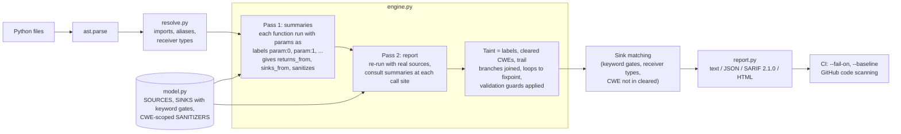
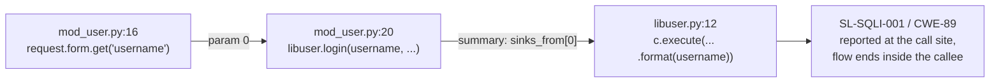

# sinkline

[](https://github.com/samiali38183/sinkline/actions/workflows/ci.yml)


**Interprocedural taint analysis for Python web apps.** sinkline follows attacker-controlled input
(Flask, FastAPI, Django and aiohttp request data, `sys.argv`, `os.environ`, ...) through your code,
across functions and files, and reports it only when it reaches a dangerous sink (SQL, shell, `eval`,
file paths, redirects, deserialization, ...) without a sanitizer for *that* bug class. Every finding
carries the source-to-sink path, an OWASP 2021 category and a CWE, and can be exported as SARIF for
GitHub code scanning.

On a 109-line labeled corpus it scores **precision 0.983 / recall 0.951 / F1 0.967**, against
0.623 / 0.541 / 0.579 for bandit on the same lines. On a cross-file SQL injection in the public
`vulpy` training app it reports the vulnerable `bad/` tree and nothing in the `good/` tree. The
benchmark is small and self-labeled; see [Limitations](#limitations) before reading much into it.

It is pure Python on the standard `ast` module, with zero dependencies.

```
$ sinkline scan vulpy        # fportantier/vulpy @ 5249cc8, first of 3 findings

[CRITICAL] SL-SQLI-001 A03:2021 CWE-89  bad/mod_user.py:20:20
  SQL built from tainted data
  flask.request.form reaches sqlite3.Cursor.execute (inside login, bad/libuser.py:12) without a sanitizer for CWE-89.
  ┌ source     bad/mod_user.py:16  username = request.form.get('username')  # flask.request.form
  │ propagate  bad/mod_user.py:16  username = request.form.get('username')  # .get()
  │ call       bad/mod_user.py:20  username = libuser.login(username, password)  # passed as `username` to login()
  └ sink       bad/libuser.py:12  user = c.execute("SELECT * FROM users WHERE username = '{}' and password = '{}'".format(username  # sqlite3.Cursor.execute inside login()
  fix: Use parameterized queries: cursor.execute('... WHERE id = ?', (user_id,))
```

## Contents

[The problem](#the-problem) · [How it works](#how-it-works) · [Engineering decisions](#engineering-decisions) ·
[Results](#results) · [Quick start](#quick-start) · [Usage](#usage) · [Real-world use](#real-world-applicability) ·
[Limitations](#limitations) · [Roadmap](#roadmap) · [Development](#development)

## The problem

Pattern-matching linters report one finding per `cursor.execute(...)` whether the argument came from
a config file or from `request.args`, and they cannot tell the parameterized query from the string-built
one. Reviewers then ignore the output. The question a security reviewer actually asks is: **can
attacker-controlled data reach this sink without passing through something that neutralizes it for
this bug class?** That is a data-flow question, and in web apps the answer usually crosses a function
or file boundary (a view reads `request.form`, a `libuser.login()` helper builds the SQL).

sinkline answers that question statically, without running the app, and reports the path so the
finding can be triaged in seconds.

## How it works



Two-pass summaries are what make the `vulpy` finding above possible. The sink is in
`bad/libuser.py`; the source is in `bad/mod_user.py`:



Details of the abstract domain, guards, summaries and name resolution are in
[`docs/DESIGN.md`](docs/DESIGN.md) (kept as the authoritative design write-up).

## Engineering decisions

Each of these is implemented in the code and covered by tests; the reasoning is expanded in
[`docs/DESIGN.md`](docs/DESIGN.md).

- **Two-pass function summaries, not whole-program inlining.** Pass 1 analyzes every function once
  with its parameters bound to symbolic labels (`param:i`) and records which parameters reach the
  return value, which reach sinks (transitively), and whether the function is a thin sanitizer
  wrapper. Pass 2 reuses the summary at every call site. Analysis stays linear in program size and a
  sink two calls deep (`test_two_hop_sink`) is still found. The cost: summaries are
  context-insensitive, and the summary pass runs a fixed two rounds, so deeper helper chains can be
  missed (see Limitations).
- **CWE-scoped sanitizers.** A taint value carries the set of CWEs it has been cleaned for.
  `shlex.quote` clears command injection only, `html.escape` clears XSS only, `int()` clears
  everything. Treating sanitization as one global boolean makes a shell-safe value look SQL-safe, a
  common false-negative source in simple taint tools (`test_shlex_quote_clears_cmdi_only`,
  `test_html_escape_clears_xss_only`).
- **Join = union of labels, intersection of cleared CWEs.** When two branches merge, a value stays
  sanitized only if both branches sanitized it. This is also how validation guards work:
  `if not x.isdigit(): abort()`, `if x not in ALLOWED: return`, `if ".." in f`, `re.fullmatch`,
  `urlparse(x).netloc == ""` and `try: int(x) except: abort()` clear taint, but only on paths where
  the check holds, and the guard is CWE-scoped (a `..` check is a path guard, not a shell guard).
- **Sources, sinks and sanitizers are data.** `model.py` is a declarative table (30 source
  entries, 138 sink signatures, 38 sanitizer entries). Argument-dependent risk is a keyword gate on
  the sink row (`subprocess.run(shell=True)`, `yaml.load` without `SafeLoader`,
  `torch.load(weights_only=...)`) rather than engine special cases. Adding a sink is one line.
- **Module-qualified summary keys, with ambiguity poisoning.** `bad/libuser.py::login` is
  `bad.libuser.login`; a short alias is usable only when unambiguous, and call sites resolve
  relative to their own package first. This is why `vulpy`'s `bad/` and `good/` trees, which define the
  same function names, produce different results. Library names never fall back to a bare-name user
  function (`subprocess.run` cannot hit a user function called `run`).
- **Typed framework parameters are not sources.** FastAPI path parameters annotated `int`, `float`,
  `bool` or `UUID` are treated as already coerced.
- **Fingerprints exclude line numbers.** Rule + file + function + normalized sink text, so a
  `--baseline` survives unrelated edits (`test_fingerprint_stable_across_line_shift`).
- **Known limits are labeled in the benchmark, not hidden.** Design-limit misses are tagged
  `known FN` / `known FP` in `bench/corpus/hard_app.py` and counted in the headline score.
  `tests/test_corpus.py` fails CI if precision drops under 0.98 or recall under 0.95, or if any miss
  is not a documented one.

What it recognizes, in short: assignments, f-strings, `%`/`.format`, slicing, string methods,
containers, comprehensions, `await`, augmented assignment, loops, `try/except`, cross-function and
cross-file flows. 42 rules in 8 OWASP 2021 categories (A01, A02, A03, A05, A07, A08, A09, A10):
SQLi, command injection, code injection, SSTI, XSS, path traversal, Zip/Tar Slip, open redirect,
SSRF, deserialization (`pickle`, `yaml`, `torch.load`, `marshal`, `shelve`, `numpy.load`), weak
hashing, log injection, XXE, LDAP/XPath/NoSQL injection, ReDoS, and a few auth rules. Nothing is
mapped to A04 (Insecure Design) or A06 (Vulnerable Components); `sinkline rules` lists all of them.

## Results

All figures reproduced on 2026-11-05 (Python 3.12.2; also run on 3.10 and 3.13 with identical
results). Commands are in [Development](#development).

### Labeled benchmark

`bench/corpus/` has 109 hand-labeled lines in Flask, FastAPI, Django and CLI code (61 vulnerable,
48 safe variants of the same patterns, including cross-file and adversarial cases). `bench/score.py`
counts a true positive when a labeled `VULN:CWE-xx` line produces a finding with that CWE, and a
false positive when a `SAFE` line produces any finding. No findings land on unlabeled lines.

| tool | TP | FP | FN | TN | precision | recall | F1 |
|---|---|---|---|---|---|---|---|
| sinkline 0.3.0 | 58 | 1 | 3 | 47 | 0.983 | 0.951 | 0.967 |
| bandit (lenient: any hit on a vulnerable line counts) | 33 | 20 | 28 | 28 | 0.623 | 0.541 | 0.579 |

- sinkline's 3 FN and 1 FP are all labeled known limits in `hard_app.py` (`hard_app.py:183` CWE-78,
  `:211` and `:224` CWE-89, and the FP at `:84`). Per-CWE counts are in `python bench/score.py`.
- The bandit row reproduces with bandit 1.8.3, 1.8.6 and 1.9.4. bandit 1.8.0 gives 32/21/29/27
  (0.604 / 0.525 / 0.561), so the previously published figure depends on the bandit version.
- Read this comparison as scope, not as a verdict on bandit. bandit is a pattern linter with no
  data-flow model. Its 20 false positives are mostly rules that fire on any string-built SQL
  (B608 x10) or any `subprocess` import/call (B603/B607/B602/B605) even on the labeled-safe variants,
  and its misses sit in categories where it has no taint-based rule (labeled SQLi 9, XSS 5, path
  traversal 5, open redirect 4, command injection 3). I have not benchmarked against Semgrep or
  CodeQL.

### Public projects

Cloned at the listed commits and scanned with `sinkline scan <dir>`; full output in
[`docs/examples/`](docs/examples/). These are not labeled, so the table reports what was found, not recall.

| repo | commit | findings | notes |
|---|---|---|---|
| [fportantier/vulpy](https://github.com/fportantier/vulpy) | `5249cc8` | 3 x CWE-89 (57 files, 216 functions) | all three in `bad/`, flowing `mod_user.py` to `libuser.py` across files; 0 findings in `good/` (re-scanned separately), which has the same function names |
| [we45/Vulnerable-Flask-App](https://github.com/we45/Vulnerable-Flask-App) | `b6a4f97` | 4: SSTI (CWE-1336), SQLi (CWE-89), XSS (CWE-79), MD5 (CWE-328) | 4 CWEs in 2 OWASP categories (A02, A03) |
| [anxolerd/dvpwa](https://github.com/anxolerd/dvpwa) | `a1d8f89` | 1 x CWE-89, 1 x CWE-117 | aiohttp, async handlers |
| [miguelgrinberg/microblog](https://github.com/miguelgrinberg/microblog) | `a975ef6` | 0 | the `urlsplit(next_page).netloc != ''` redirect check in `app/auth/routes.py` is treated as a guard |

Three of these are intentionally vulnerable training apps. A clean result on `microblog` is
consistent with the guard handling working, but zero findings is not proof the app is safe. No CVEs
or confirmed real-world vulnerabilities are claimed.

## Quick start

Python 3.9+, no dependencies.

```bash
pip install git+https://github.com/samiali38183/sinkline
sinkline scan path/to/app                       # text report with source to sink paths
sinkline scan . --format sarif -o out.sarif      # upload to GitHub code scanning
sinkline scan . --fail-on high                   # exit 1 for CI if anything high or critical
sinkline explain SL-CMDI-003                     # what a rule matches and why
```

To see it on the benchmark instead of your own code:

```bash
git clone https://github.com/samiali38183/sinkline && cd sinkline
pip install -e ".[dev]"
sinkline scan bench/corpus/flask_app.py          # 21 findings, each with its flow
pytest -q                                        # 37 tests including the corpus gate
python bench/score.py                            # precision 0.983  recall 0.951  F1 0.967
```

## Usage

```bash
sinkline scan path/to/app                        # text report
sinkline scan . --format sarif -o out.sarif      # GitHub code scanning (SARIF 2.1.0 with codeFlows)
sinkline scan . --format html -o report.html     # self-contained shareable file
sinkline scan . --format json -o base.json       # machine-readable, stable fingerprints
sinkline scan . --baseline base.json             # only findings not in the baseline
sinkline scan . --fail-on high                   # exit 1 at/above a severity
sinkline scan . --min-confidence high            # drop low-confidence flows
sinkline scan . --rule A03:2021 --rule CWE-79    # restrict by rule id, OWASP category or CWE
sinkline scan . --exclude-tests
sinkline rules                                   # 42 rules, 138 sink signatures, by OWASP category
sinkline explain SL-CMDI-003
```

Verified on `vulpy`: a JSON scan, then `--baseline` against it, reports 0 findings; `--fail-on high`
exits 1 on the original scan.

As a GitHub Action:

```yaml
- uses: samiali38183/sinkline@main
  with:
    path: .
    fail-on: high
```

Python API:

```python
from sinkline import scan_path
res = scan_path("src/")
for f in res.findings:
    print(f.rule_id, f.cwe, f.file, f.line, [s.kind for s in f.flow])
```

## Real-world applicability

- **PR gate for Python web services.** The SARIF output puts the source-to-sink path in the code
  scanning UI; `--fail-on` and `--baseline` support adopting it on an existing codebase by failing
  only on new findings.
- **Triage aid for reviews and training apps.** The flow trail makes it quick to confirm or dismiss
  a finding, and to teach why a given sanitizer was or was not enough.
- **Where it should not be the only control.** It is reachability analysis, not exploit proof, it
  is Python-only, and it has the blind spots listed below. It is a complement to a mature SAST
  or review process, not a replacement; no head-to-head against those tools has been run.

## Limitations

- **Small, self-labeled benchmark.** 109 lines, labeled by the author, who also wrote the engine.
  The corpus doubles as a regression suite (the CI floor is the recorded score), so the headline
  numbers are best read as "no regressions, and the design limits are visible", not as a
  generalization estimate. The public-project scans are the more independent check, but they are
  unlabeled and few.
- **Known design limits** (labeled `known FN` / `known FP` in `bench/corpus/hard_app.py`):
  - object fields across methods (`self.target = request.args[...]` in one method, `os.system(self.target)` in another; needs a heap model);
  - closures capturing tainted variables;
  - module globals shared across requests (`CACHE["q"] = tainted` in one handler, read in another);
  - key-insensitive dicts: `{"id": 1, "note": tainted}["id"]` reads as tainted (the one FP);
  - `if/elif` equality chains used as allowlists (the `not in (...)` form is recognized);
  - dynamic dispatch, `getattr`, `exec`-generated code, decorators that rewrite arguments.
- **Python only.** No JavaScript templates; ORM query builders are modeled only at the raw-SQL entry
  points (`sqlalchemy.text`, `QuerySet.raw`, `Session.execute`); no type inference beyond receiver
  resolution.
- **Summaries are context-insensitive** (one per function, not per call site).
- **No coverage for A04 and A06** OWASP categories (see above).
- **Summary pass is two fixed rounds, not a fixpoint.** Pass 1 runs over all files twice
  (`engine.py`, `scan_path`). A chain of three or more helper functions between the source and the
  sink can be missed when the helpers are defined caller-first; in a synthetic check, a view calling
  `h0` to `h1` to `h2` (sink) was not reported, while two helpers, or the same three defined
  callee-first, were. Chains of two helpers (`test_two_hop_sink`) are covered.
- **`re.escape` is registered as a sanitizer for CWE-89 (SQL injection) as well as CWE-1333
  (`model.py`).** It escapes regex metacharacters, not SQL syntax, so treating it as a SQL sanitizer
  can hide a real injection: a tainted value passed through `re.escape` and concatenated into a query
  produces no finding.
- **CI scope.** The test matrix is Python 3.9, 3.12 and 3.13 on Linux, Windows and macOS
  (`.github/workflows/ci.yml`).

## Roadmap

Directions that follow from the limits above; none are implemented:

- Heap/field model for `self.attr` flows across methods, and closure capture.
- Key-sensitive dict and list tracking to remove the benchmark's one false positive.
- Equality-chain allowlists (`if/elif/else: abort()`) as guards.
- More labeled real-world projects to replace the self-labeled benchmark as the headline number.

## Development

```bash
pip install -e ".[dev]"
pytest -q                       # 37 tests: engine unit tests plus the corpus gate
python bench/score.py -v        # corpus P/R/F1, per-CWE table, per-line FP/FN listing
pip install bandit && python bench/compare_bandit.py
```

```
sinkline/
  engine.py    ~1190 lines  abstract interpreter, summaries, guards, fixpoint
  model.py      ~420 lines  sources / sinks / sanitizers / OWASP+CWE table
  resolve.py    ~150 lines  import + alias + receiver-type resolution
  report.py     ~220 lines  text / JSON / SARIF 2.1.0 / HTML
  cli.py        ~130 lines
bench/
  corpus/       labeled ground truth (VULN:CWE-xx / SAFE tags) incl. cross-file + adversarial cases
  score.py      precision / recall / F1 per CWE
  compare_bandit.py
tests/          unit tests (one small program per engine feature) + corpus gate
docs/DESIGN.md  design write-up
docs/examples/  real scan output (vulpy, Vulnerable-Flask-App, dvpwa, corpus as HTML and SARIF)
```

## License

MIT
