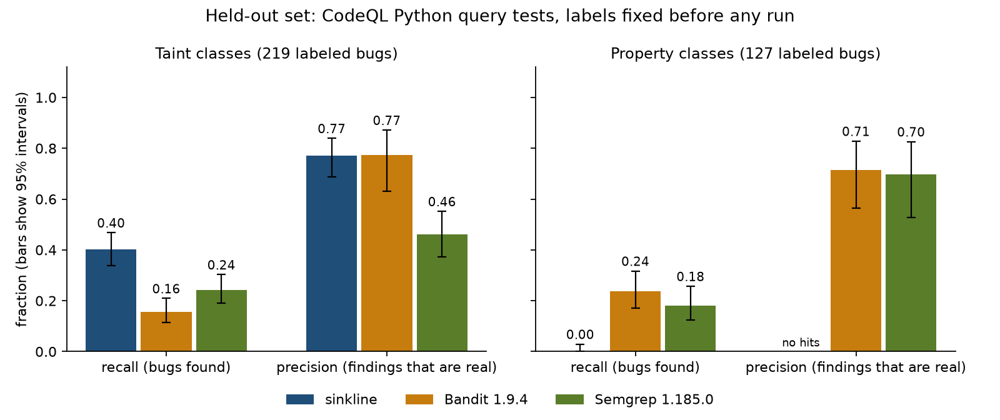

# Held-out evaluation

The earlier benchmark numbers in the README are not held out. The 109-line corpus was labeled by the person who
wrote the engine, and the 0.5.0 changes were chosen by reading OWASP BenchmarkPython's misses. sinkline also
scores below Bandit over all 14 BenchmarkPython categories. This page describes a test set that none of that tuning
touched, how it was frozen, and what came out.

## Method

- Data: GitHub's CodeQL Python query tests (`python/ql/test/query-tests/Security`, commit `20ed6480`). These are
  small Flask, Django, FastAPI and similar programs with inline expectations, written for a different analyzer.
  36 test directories (80 files) were used, with 346 labeled vulnerable lines.
- Freeze: the label manifest (`bench/heldout/manifest.json`, sha256 `cd529aec...c881c`), the scorer, the
  protocol and the ablation switch were merged in [PR #10](https://github.com/samiali38183/sinkline/pull/10)
  (merge commit `1506a5d`) before any tool was run on the set. The runner refuses to start if the manifest or a
  source file hash differs. The full rules are in [`bench/heldout/PROTOCOL.md`](../bench/heldout/PROTOCOL.md).
- No tuning: no sinkline code was changed after the freeze. Where results show a bug or a gap, it is listed
  below and left as is.
- Tools, one run each, same files, default settings: sinkline (main at the freeze), Bandit 1.9.4, Semgrep OSS
  1.185.0 with the `p/python` and `p/owasp-top-ten` registry rules (local copies, hashes in the results metadata).
  Semgrep ran with an empty `.semgrepignore`, because its default ignore list skips test-like paths.
- Two tiers, never blended. Taint classes (16 directories, 219 labeled bugs) are source-to-sink classes sinkline
  has rules for. Property classes (127 labeled bugs) are single-call or configuration checks such as weak
  crypto, cookie flags and cleartext storage, which sinkline does not attempt. They are included so the result
  is not limited to what sinkline was built to find.
- Scoring: a finding with a CWE in the directory's accepted set is matched one-to-one to the nearest labeled
  line within 3 lines. Matched is a true positive, an unmatched labeled line is a miss, and an unmatched in-class
  finding is a false positive. Findings of other CWEs are ignored.

## Results

Run on 2026-11-14, Python 3.12.2, Windows 11. Intervals are 95% Wilson. Raw output is in
[`bench/heldout/results/2026-11-14/`](../bench/heldout/results/2026-11-14/).

Taint classes, 219 labeled bugs:

| tool | found | missed | false positives | precision | recall | macro recall | seconds |
|---|---|---|---|---|---|---|---|
| sinkline | 88 | 131 | 26 | 0.77 (0.69-0.84) | 0.40 (0.34-0.47) | 0.62 | 8.7 |
| Bandit 1.9.4 | 34 | 185 | 10 | 0.77 (0.63-0.87) | 0.16 (0.11-0.21) | 0.21 | 1.9 |
| Semgrep OSS 1.185.0 | 53 | 166 | 62 | 0.46 (0.37-0.55) | 0.24 (0.19-0.30) | 0.16 | 26.0 |

Property classes, 127 labeled bugs:

| tool | found | missed | false positives | precision | recall |
|---|---|---|---|---|---|
| sinkline | 0 | 127 | 1 | no true positives | 0.00 (0.00-0.03) |
| Bandit 1.9.4 | 30 | 97 | 12 | 0.71 (0.56-0.83) | 0.24 (0.17-0.32) |
| Semgrep OSS 1.185.0 | 23 | 104 | 10 | 0.70 (0.53-0.83) | 0.18 (0.12-0.26) |

Macro recall is the mean of per-directory recall. It is shown because SSRF alone is 89 of the 219 taint bugs
and sinkline finds 22 of them.

### Ablation

| sinkline variant | taint found | taint false positives | precision | recall |
|---|---|---|---|---|
| full | 88 | 26 | 0.77 | 0.40 |
| interprocedural summaries off | 88 | 26 | 0.77 | 0.40 |
| validation guards off | 91 | 39 | 0.70 | 0.42 |

Turning the interprocedural analysis off changed no taint result on this set. The CodeQL snippets almost never
send a source through a user function into a sink in another function, so this set cannot show whether the
interprocedural analysis helps. The claim that it does rests on the self-labeled corpus and on the `vulpy`
cross-file example, not on this evidence. Turning guards off adds 13 false positives (6 more of them on lines labeled safe) and 3 more finds, so guards
earn their keep on precision.

### What the numbers say, and do not

- On the classes it was built for, sinkline found more of the labeled bugs than Bandit or Semgrep OSS with the
  default registries, at a precision equal to Bandit's and higher than Semgrep's. Bandit and Semgrep OSS have
  few rules for most of these classes, as in the BenchmarkPython run.
- It still missed 60% of the taint bugs. Recall is 0.40 here against 0.73 on BenchmarkPython, which is the size
  of the effect of tuning on the benchmark that motivated the changes.
- It found nothing in the property classes, where Bandit and Semgrep found 24% and 18%. Over both tiers combined
  sinkline found 88 of 346 labeled bugs, Bandit 64 and Semgrep 76.
- All 23 NoSQL injection bugs were missed although sinkline has a rule for that class. The likely cause is
  receiver-type resolution for `pymongo` attribute chains such as `mongo.db.user.find(...)`. I did not confirm
  this and did not change it.
- Redirects: 9 of 9 found, with 10 false positives, two of them on lines the file's own comments mark `# OK` (95 and 106). The protocol
  counts those as false positives.

### Limits of this evaluation

- Labels come from CodeQL's test annotations, so they reflect what CodeQL's authors chose to mark. A real
  bug on an unlabeled line is counted as a false positive for every tool, which makes all precision figures lower
  bounds. Only 26 lines are labeled safe; most of the safe code is implicit.
- Snippet-sized test programs are not production apps. They are also written to exercise CodeQL's models, so
  some framework cases favor or disfavor any tool in ways that say little about real code.
- One run, one machine. Runtimes are wall-clock for scanning all 80 files and include process start-up.
  Semgrep time includes loading about 2,000 rules.
- The author read one of the 80 files (`command_injection.py`) while checking the label format, before the freeze.
- Bandit and Semgrep are pattern tools. Semgrep OSS with taint rules written for this set, CodeQL, Pysa and
  Joern were not run, and would likely do better than the registry run.
